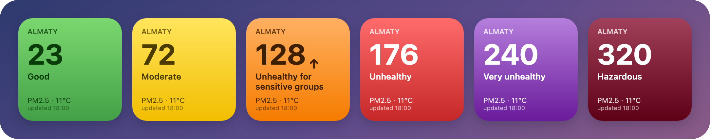
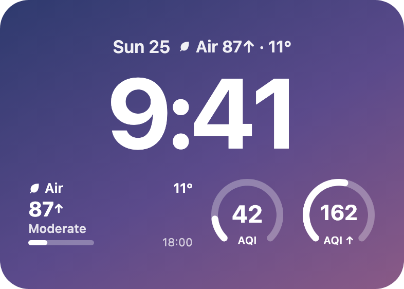
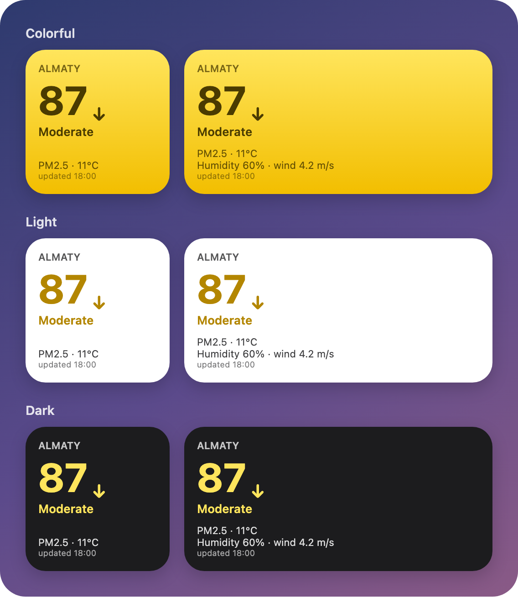
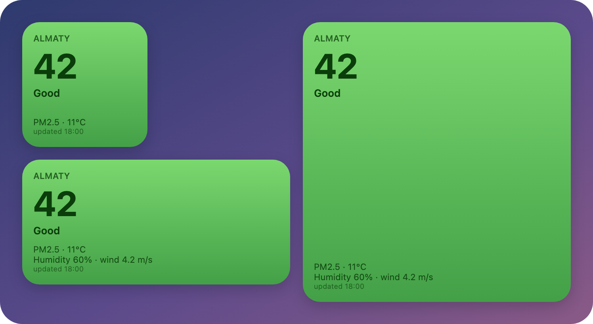
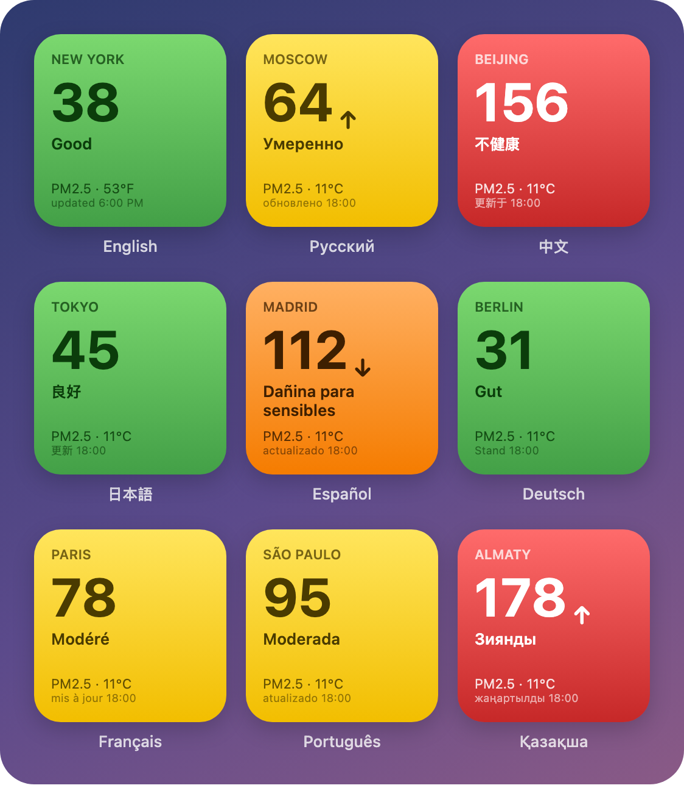

# IQAir AQI widget for Scriptable

An iOS home screen and lock screen widget that shows the current air quality index (US AQI) from [IQAir](https://www.iqair.com/), built with [Scriptable](https://scriptable.app/).



<p align="center">
  
</p>

- AQI with a color for the AQI level and an arrow showing the trend since the last reading
- Four themes: colorful, light, dark, or matching the system appearance
- Main pollutant, temperature, humidity and wind
- Uses your current location by default, or a fixed city or coordinates
- Small, medium and large home screen widgets, plus all three lock screen sizes
- Keeps working offline: when a request fails, the widget shows the last cached reading and marks it as cached
- Available in English, Russian, Chinese (Simplified), Japanese, Spanish, German, French, Portuguese and Kazakh, picked from the device language. Other languages fall back to English
- Temperature, wind units and time format follow your region (°C/°F, m/s, km/h or mph, 24- or 12-hour time)

## Screenshots

**Themes**



**Sizes**



**Languages**



The screenshots are generated from the real script with mock data (see [Development](#development)), so they can differ slightly from what iOS draws.

## Requirements

- iPhone or iPad with [Scriptable](https://apps.apple.com/app/scriptable/id1405459188)
- A free IQAir API key (Community plan)

## Getting an API key

1. Sign up at [dashboard.iqair.com](https://dashboard.iqair.com/).
2. Create a key on the **Community** plan. It's free and its limits are well above what the widget needs.
3. Copy the key. You'll paste it into the script on first run.

## Installation

**Option A: import the `.scriptable` file**

1. On your iPhone, download [`iqair-aqi.scriptable`](iqair-aqi.scriptable).
2. Open it and choose **Scriptable** in the share sheet. The script is added as **IQAir AQI**.

**Option B: copy the source**

1. In Scriptable, create a new script.
2. Paste the contents of [`src/iqair-aqi.js`](src/iqair-aqi.js).

**Then:**

1. Run the script once inside Scriptable. It asks for your API key and stores it in the iOS Keychain, so the key never sits in the script itself. Then it asks you to pick a theme.
2. Add a Scriptable widget to your home or lock screen, tap it while editing, and pick **IQAir AQI** as the script.

## Choosing a location

Set the location with the widget's **Parameter** field:

| Parameter | Result |
| --- | --- |
| *(empty)* or `auto` | The station nearest to your current location. If location access isn't available, IQAir guesses from your IP address |
| `Los Angeles, California, USA` | A specific city as `city, state, country` |
| `43.24, 76.89` | The station nearest to these coordinates (`lat, lon`) |

For the default mode, allow Scriptable to use your location **While Using the App or Widgets** in iOS Settings. Without it, the IP-based guess can be off, especially on mobile data or VPN. If getting the location takes too long, the widget uses the last known location instead.

City, state and country must be spelled the way IQAir spells them. The easiest way to check is to find the city on [iqair.com](https://www.iqair.com/) and copy the names from the page breadcrumbs.

Each location has its own cache, so you can have several widgets with different parameters.

## Lock screen

Lock screen widgets have a transparent background and follow the system tint, like Apple's own widgets.

| Size | Shows |
| --- | --- |
| Rectangular | Leaf icon, "Air", temperature, AQI with trend arrow, level, a 0–300 scale bar and the reading time |
| Circular | A 0–300 ring gauge with the AQI in the middle |
| Inline (above the clock) | Leaf icon, "Air", AQI with trend arrow and temperature |

Scriptable's in-app previews of lock screen widgets are only estimates, so check the result on the lock screen itself. iOS sets the margins of lock screen widgets. The one exception is the circular ring, which should reach the edge of the circle: `RING_PAD` in the script is negative to cancel out the system margin. If the ring gets clipped at the edges, move it closer to `0`. If it still looks small, make it more negative.

## Themes

| Theme | Look |
| --- | --- |
| Colorful *(default)* | The background is a gradient in the AQI level color |
| Light | White background, the AQI number and level are shown in the level color |
| Dark | Dark background, the AQI number and level are shown in the level color |
| Match system | Light or dark, following the iOS appearance |

Every time you run the script inside Scriptable, it shows the theme picker with the current theme checked. Tap **Keep current** to leave it as is. The theme applies to all IQAir home screen widgets. Lock screen widgets always use the system tint.

## Configuration

These constants at the top of the script can be changed:

| Constant | Default | Meaning |
| --- | --- | --- |
| `API_KEY` | `""` | Hardcode a key here instead of using the Keychain |
| `TEMP_UNIT` | `"auto"` | `"C"` or `"F"`. `"auto"` picks °F in the US and a few other countries, and °C elsewhere |
| `WIND_UNIT` | `"auto"` | `"ms"`, `"kmh"` or `"mph"`. `"auto"` picks mph in the US and UK, m/s in countries that use it (Russia, Kazakhstan, China, Japan, the Nordics and others), and km/h elsewhere |
| `LOCATION_TIMEOUT_SEC` | `5` | How long to wait for the current location before falling back to the last known one, or to IP |
| `REFRESH_MIN` | `20` | How often the widget asks iOS to refresh, in minutes |
| `MIN_FETCH_MIN` | `10` | If iOS refreshes sooner than this, the cached reading is reused without a request |

iOS decides when widgets actually refresh, so `REFRESH_MIN` is a lower bound. IQAir itself updates readings about once an hour.

To change a saved API key, run the script in the app after the key stops working (it's cleared automatically on an "invalid key" error), or remove `iqair-api-key` with `Keychain.remove("iqair-api-key")` from any script.

## AQI levels

| AQI | Level |
| --- | --- |
| 0–50 | Good |
| 51–100 | Moderate |
| 101–150 | Unhealthy for sensitive groups |
| 151–200 | Unhealthy |
| 201–300 | Very unhealthy |
| 301+ | Hazardous |

## Development

The source lives in [`src/iqair-aqi.js`](src/iqair-aqi.js). After editing it, regenerate the importable file:

```bash
npm run build
```

This writes `iqair-aqi.scriptable`, a JSON file holding the script and its icon settings, which the Scriptable app can import. Commit both files.

### Screenshots

```bash
npm run screenshots
```

This regenerates the images in `docs/screenshots`. It needs Google Chrome or Chromium; set `CHROME_PATH` if it isn't found automatically. How it works:

1. [`scripts/screenshots/stubs.mjs`](scripts/screenshots/stubs.mjs) replaces the Scriptable APIs with mocks that record the widget instead of drawing it, and serves mock IQAir data.
2. [`scripts/screenshots/index.mjs`](scripts/screenshots/index.mjs) runs the unchanged widget script once per scenario (size, theme, language, AQI) and saves each recorded widget as JSON.
3. [`scripts/screenshots/renderer.js`](scripts/screenshots/renderer.js) lays the widgets out in HTML following Scriptable's layout rules, and replays the drawing commands on canvas.
4. Headless Chrome captures each page as a PNG.

To add or change a screenshot, edit `PAGES` in `index.mjs`.

## License

[MIT](LICENSE)

Air quality data is provided by IQAir. This project isn't affiliated with IQAir.
